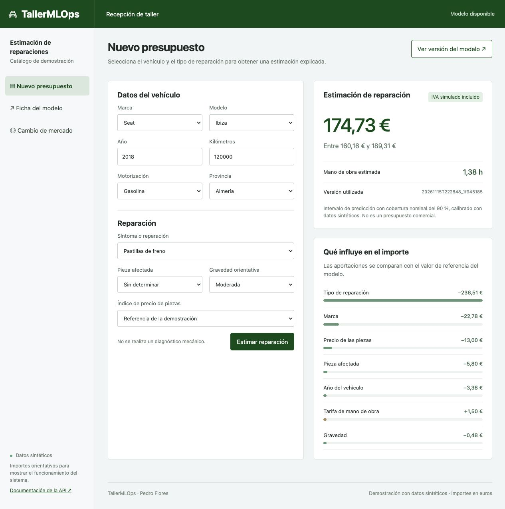
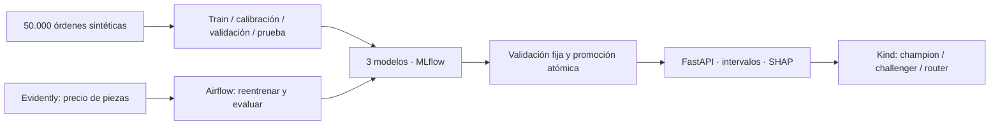
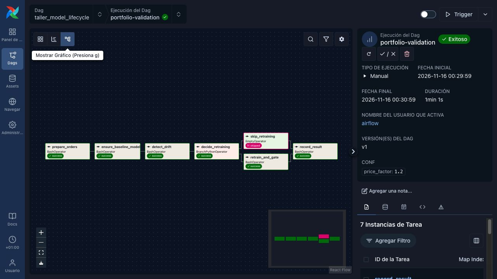
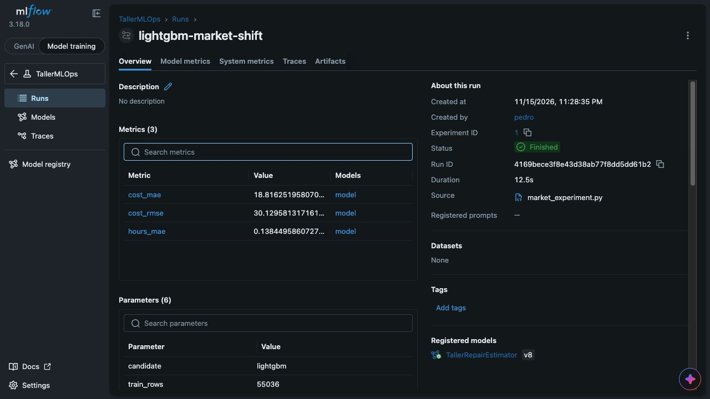

# TallerMLOps

Estimador de reparaciones que muestra el importe, un intervalo orientativo y los factores que lo explican. Incluye el ciclo completo del modelo: entrenamiento, seguimiento, detección de cambios, reentrenamiento y despliegue gradual.

**Python · scikit-learn · XGBoost · LightGBM · MLflow · SHAP · Evidently · Airflow · Kubernetes**



## Probarlo

```sh
docker compose up --build -d api
```

Abrir **http://localhost:5105**. El repositorio incluye dos checkpoints pequeños entrenados con datos sintéticos, verificados mediante SHA-256. No necesita cuentas. [Recorrido visual](docs/demo.gif) · [Ejemplo de cambio de precios](docs/market.jpg).

## Qué demuestra

- Predice coste con IVA simulado y horas de trabajo para un catálogo de vehículos y reparaciones.
- Explica el coste con SHAP, agrupando las categorías por su característica original y comprobando la suma de las aportaciones.
- Compara Random Forest, XGBoost y LightGBM con un conjunto de validación fijo.
- Detecta una subida simulada del precio de piezas, entrena candidatos y promueve solo si mejoran al menos un 0,5 %.
- Sirve dos versiones en Kubernetes, reparte tráfico y sustituye instancias con peticiones en curso.

## Arquitectura



| Carpeta | Función |
|---|---|
| `pipelines/` | Generación reproducible, entrenamiento y experimento de mercado |
| `taller/` | Registro local, inferencia, explicación, API, interfaz y router |
| `monitoring/` | Informe Evidently y regla de deriva de una variable crítica |
| `airflow/` | DAG con generación, deriva, bifurcación, reentrenamiento y control de promoción |
| `k8s/` | Dos réplicas champion, una challenger, servicios y router |
| `data/demo/` | Checkpoints y resultados de la ejecución publicada |

## Resultados medidos

Las cifras siguientes corresponden a las ejecuciones guardadas, no a datos de un taller real.

| Prueba local | Resultado |
|---|---|
| Conjunto inicial | 50.000 órdenes, semilla 42; separación por identificador antes de entrenar |
| Modelo inicial elegido | LightGBM; MAE de coste en prueba **23,53 €** |
| Modelo después del reentrenamiento | LightGBM; MAE de coste en prueba **18,47 €**, cobertura observada del intervalo **90,77 %** |
| Cambio de mercado, evaluación independiente de 4.000 órdenes | MAE **30,23 → 19,70 €**, mejora **34,82 %** |
| DAG real en Airflow 3.4 | Flujo completo correcto; seis tareas realizadas y una rama omitida deliberadamente |
| Repetición en Airflow / Docker | Promoción correcta; mejora **33,29 %** en su evaluación independiente |
| Canary real en Kind | 500 peticiones: **446 champion / 54 challenger**, sin recurrir al respaldo durante la medición |
| Sustitución de instancias en Kind | **160 respuestas correctas, 0 errores** durante esa prueba local |
| Pruebas automáticas | 11 superadas, con modelo real, aditividad SHAP, rangos, registro y router |

[Experimento completo](docs/market-experiment.json) · [Ejecución Airflow](docs/airflow-market-result.json) · [Tráfico y actualización](docs/kind-validation.json). El reparto canary usa el hash de `X-Request-ID`: el porcentaje configura una distribución, no una cuota exacta en cada muestra. Se comprueba que ambos servicios estén disponibles antes de medir. La prueba local no garantiza disponibilidad bajo cualquier carga.



## Datos, validación e intervalos

Los importes se generan con supuestos explícitos de piezas, marca, gravedad, horas, provincia y ruido. No representan tarifas de mercado ni clientes. Las columnas que componen el coste objetivo se conservan para auditar el generador y se excluyen de las características del modelo. El catálogo es cerrado; no se diagnostica una avería a partir de texto libre.

Se separan entrenamiento, calibración, validación y prueba. La mezcla de precios base y piezas un 20 % más caras en los conjuntos de referencia se fija **antes** del primer entrenamiento. La huella del conjunto de validación debe coincidir para cualquier promoción; no se cambia el examen para favorecer al candidato. Las 20.000 órdenes nuevas de entrenamiento y las 4.000 de evaluación de mercado tienen identificadores y semillas distintos.

Los intervalos usan errores relativos del conjunto de calibración, con cobertura nominal del 90 %. La API avisa cuando un valor numérico queda fuera del rango observado; ese intervalo no está calibrado para el caso. La cobertura medida con datos sintéticos no implica la misma cobertura en reparaciones reales.

## Entrenar y repetir el experimento

```sh
docker compose --profile training run --build --rm train
docker compose --profile training run --rm market
docker compose --profile tracking up -d mlflow
```

MLflow: **http://localhost:5115**. Estos comandos generan un historial nuevo en el volumen `training`. La API inicial usa los checkpoints incluidos; para servir el modelo recién entrenado, montar su carpeta de artefactos y configurar `ARTIFACT_DIR`. La captura de abajo muestra la ejecución original, con sus métricas y registros reales.



Alternativa con Python 3.12 y uv:

```sh
uv sync --extra training --extra test --frozen
uv run python -m pipelines.generate --folder data/private
uv run python -m pipelines.train --data data/private --artifacts artifacts
uv run python -m pipelines.market_experiment --data data/private --artifacts artifacts
uv run pytest -q
```

En macOS, XGBoost/LightGBM necesitan OpenMP; instalarlo mediante el gestor de paquetes elegido y hacer accesible `libomp` al proceso. Docker incluye la biblioteca Linux requerida. Los artefactos usan serialización de Python: cargar únicamente los checkpoints generados por este proyecto o una fuente de confianza. La huella detecta alteraciones del archivo; no convierte un archivo de origen desconocido en seguro.

## Automatización y despliegue

[Guía Airflow](airflow/README.md) · [Prueba Kind y limpieza](k8s/README.md). No se contratan servicios ni se crea un cluster cloud. El DAG queda pausado al iniciar y los puertos de las demos se publican solo en localhost.

El informe Evidently usa un umbral global del 20 % de columnas: una sola variable movida de trece no activa ese indicador global. La regla que solicita reentrenamiento comprueba específicamente `parts_price_index`: K-S con p < 0,01 y cambio de media superior al 10 %. [Informe real](docs/evidently.jpg).

Código y datos sintéticos: [MIT](LICENSE). No es una herramienta de peritación ni un presupuesto comercial.
